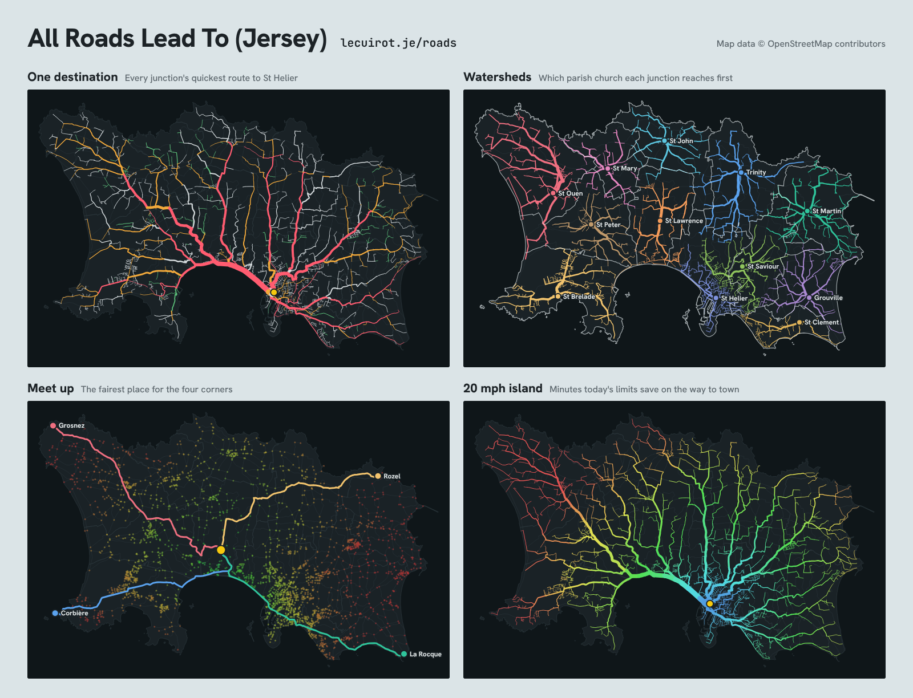

# All Roads Lead To (Jersey)



Every junction in Jersey, from the A roads to the green lanes and footpaths, routes to one destination by car, by bike or on foot, and the map draws the tree of quickest routes. Thicker lines carry more of the island. A Jersey edition of Doug Belshaw's [All Roads Lead To (UK)](https://framagit.org/dajbelshaw/all-roads-uk), which I came across in [his LinkedIn post](https://www.linkedin.com/posts/dajbelshaw_30daymapchallenge-maps-openstreetmap-share-7523387867037990913-yrNQ/), itself after Ethan Mollick's [All Roads Lead To](https://all-roads-lead-to.netlify.app/) and Arterial Mapping's “All Roads Lead to Richmond”.

Live at https://www.lecuirot.je/roads/

## Modes

Every map but the 20 mph island can travel **by car, by bike or on foot**.

- **One destination**: pick a place, a road, a beach or a landmark (or click the map). Line width shows the land area, or the people, whose quickest route uses each road. Start routes from the whole island, the same parish, or nearby.
- **Watersheds**: places compete for the island and every junction drains to the one it reaches fastest. With the twelve parish churches, the real parish boundaries are drawn on top, and the page says how much of the island is closer by road to its own parish church than to any other.
- **Meet up**: the fairest place for a group to meet (nobody travels too long, or least total travel). Presets: the four corners (Grosnez, Corbière, La Rocque, Rozel) and the twelve parishes.
- **20 mph island**: the same map with every speed limit above 20 mph cut to 20, coloured by the minutes today's limits save. (The UK edition closes the motorways instead. Closing Jersey's A roads splits the road network into hundreds of pieces, because the lanes mostly hang off the A roads rather than joining each other, so that map would mostly show cut-off pockets.)

Links work by hash: `#gorey`, `#jersey-airport`, `#la-route-de-st-aubin`, `#watersheds`, `#villages`, `#meet-up`, `#20-mph-st-helier`. Add `/bike` or `/foot` to travel that way: `#gorey/bike`, `#watersheds/foot`, `#corbiere-railway-walk/foot`.

## The model

- **Roads and paths**: every OpenStreetMap road, service road, track, footway, path, cycleway, bridleway, pedestrian street and set of steps, each used only by those allowed on it (`access`, `motor_vehicle`, `bicycle`, `foot`). Driveways, car-park aisles and private roads are left out. For each way of travelling, only the part of the network you can reach both to and from the Royal Square is kept.
- **Classes**: A roads (`trunk`, `primary`), B roads (`secondary`), other roads, green lanes (`living_street`, `green_lane=true`, or a 15 mph limit), and paths (footways, paths, cycleways, tracks, bridleways, steps).
- **By car**: roads only; one-way streets respected. An assumed average with no traffic: A roads up to 34 mph, B roads 27, C roads 25, other lanes 23, estate roads 18, green lanes 12, each capped at 85% of the posted limit, plus 3 seconds for each junction passed. No traffic lights, queues or turn costs.
- **By bike**: 16 km/h on the flat on roads, cycleways and smooth paths, 11 km/h on rough tracks; uphill the speed falls (to two thirds on a 5% climb), downhill it rises to at most 30 km/h; plus 2 seconds a junction. Bikes are pushed at walking pace along footways and pedestrian streets, and kept off steps. One-way streets are respected unless bikes are let through (`oneway:bicycle=no`, contraflow lanes).
- **On foot**: Tobler's hiking function, 5 km/h on the flat, quickest on a gentle downhill and slower up and down steep slopes; steps at 2.5 km/h. Every road and path, both ways.
- **Heights**: [Mapzen terrain tiles](https://registry.opendata.aws/terrain-tiles/) on AWS Open Data (Terrarium, zoom 13, about 12 m a pixel), sampled every 25 m along each road and path. Their sources for Jersey include EU-DEM (produced using Copernicus data and information funded by the European Union) and SRTM; see the [Tilezen attribution](https://github.com/tilezen/joerd/blob/master/docs/attribution.md). Low land behind the sea walls reads as sea level.
- **People**: the 2021 census population of each parish (Statistics Jersey, Census 2021 Bulletin 1; 103,267 in all), spread over that parish's homes by floor area (footprint × storeys) from OpenStreetMap buildings, then each home given to its nearest junction.
- **Land**: the parishes (OpenStreetMap, admin level 8) cut into 50 m squares, each given to its nearest junction. The parish polygons also draw the coastline.
- **Land and people by way of travelling**: each 50 m square and each home is given to the nearest junction that way of travelling can use, so footpath-only corners count on foot but not by car.

## Build the data

Needs `curl`, `osmium-tool` and Python 3 (standard library only).

```bash
sh build/fetch_data.sh        # downloads the Jersey extract and terrain tiles, and cuts them into data/raw
python3 build/build_graph.py  # writes graph.json
```

The extract comes from [OpenStreetMap France](https://download.openstreetmap.fr/extracts/europe/), updated daily. Delete `data/raw/jersey-latest.osm.pbf` before running `fetch_data.sh` to fetch a newer one.

Serve the folder (`python3 -m http.server`) and open `index.html`. The pages in `build/` whose names end in `-card.html` render `og.png` and `docs/modes.png`; each has its command in a comment at the top.

## Publish to lecuirot.je

The site at www.lecuirot.je serves the page from a `roads/` folder, the same way it serves `/jersey-flights/`. Copy the built files across:

```bash
sh build/publish.sh ../lecuirot.je   # copies index.html, graph.json and og.png into ../lecuirot.je/roads/
```

then commit and push that repository. The page reads `graph.json` from beside itself, so it also works at the root of any static host.

## Licence

The code is licensed under the [GNU General Public License v3.0 or later](LICENSE), as is the UK edition it is adapted from. Road, building, parish and place data © [OpenStreetMap contributors](https://www.openstreetmap.org/copyright); `graph.json` is derived from OpenStreetMap and is available under the [Open Database License 1.0](https://opendatacommons.org/licenses/odbl/1-0/). Population totals: Statistics Jersey, Census 2021. The images in `docs/` and `og.png` are maps made from OpenStreetMap data, licensed [CC BY 4.0](https://creativecommons.org/licenses/by/4.0/): credit “James Le Cuirot, map data © OpenStreetMap contributors” if you reuse them.
